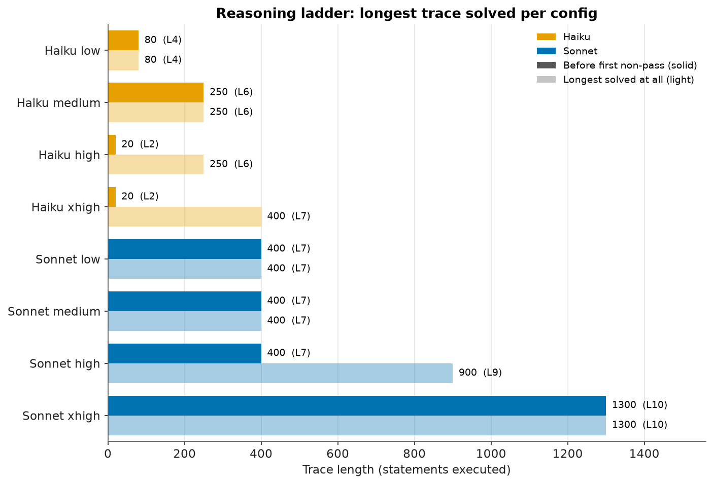
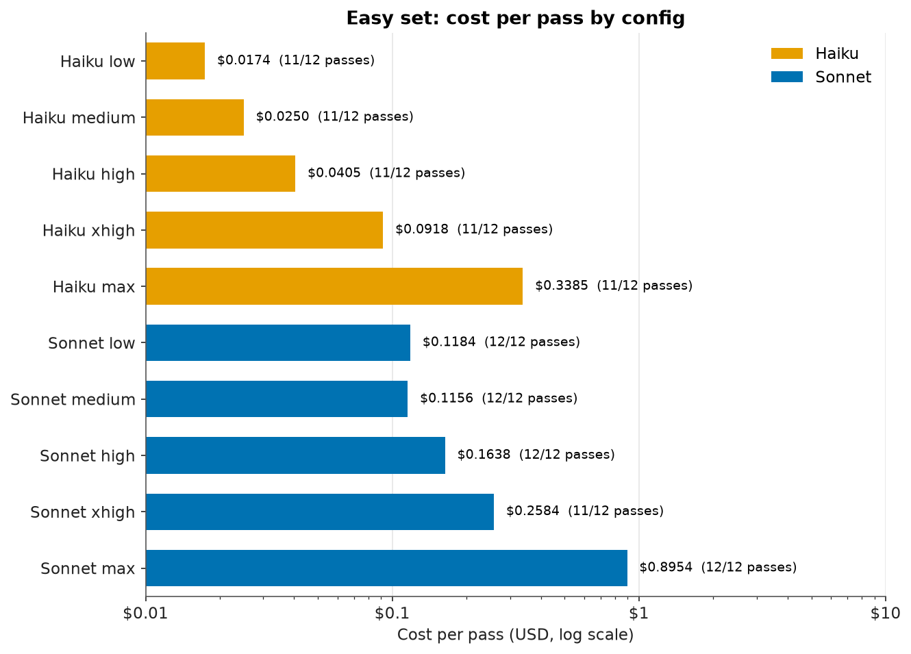
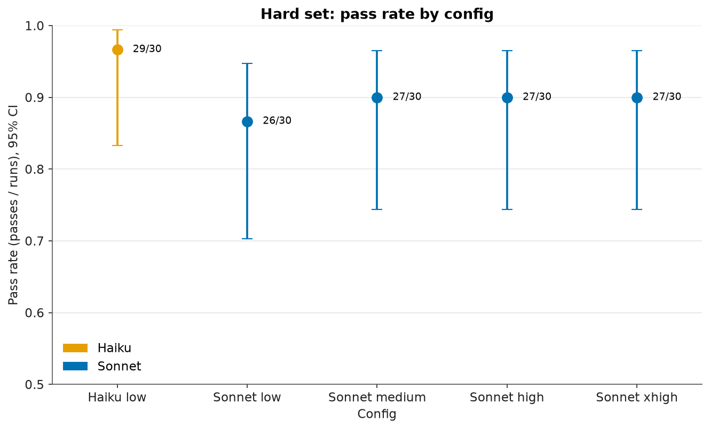
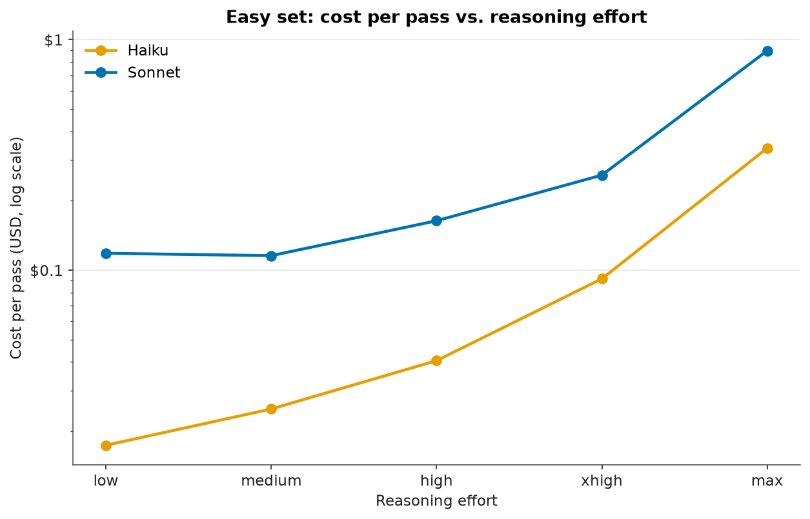
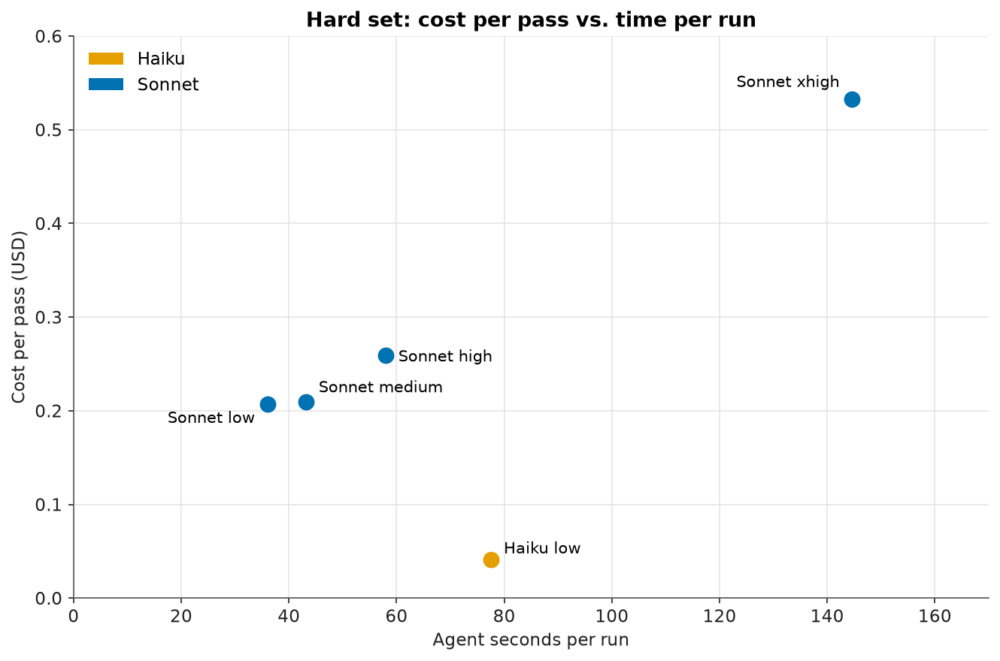

# Routing Claude sub-agents by model and effort

A case study of Claude Haiku 5.5 and Claude Sonnet 5.5 at every effort level, run as Claude Code sub-agents in cmux panes.

Technical report, November 2026. Code and data: [github.com/pleyva2004/subagent-routing-bench](https://github.com/pleyva2004/subagent-routing-bench).

## 1. Summary

Cheap, low-effort sub-agents were enough for almost every coding task we tried. Code changes barely separated the configs; code reviews and long exact reasoning without tools did.

- **Coding: Haiku `low` matched the rest on code changes at a fraction of the cost.** It passed 30 of 30 fix and feature tasks across both task sets (Wilson 95% interval 89–100%). On the easy set it missed one review bug that Sonnet `low`, `medium`, `high` and `max` found. It cost $0.041 per success on the hard set, against $0.207 for Sonnet `low` and $0.259 for Sonnet `high`.
- **Effort above `medium` bought nothing on coding.** Easy set: Sonnet `low`, `medium`, `high` and `max` went 12/12; `xhigh` and every Haiku level went 11/12. Sonnet `xhigh` cost about 2.2× Sonnet `low` per success on the easy set and 2.6× on the hard set, and `max` about 8× (Sonnet) and 20× (Haiku) its `low` level.
- **Review: a second model looks more useful than more effort.** Some misses repeated at every effort level of one model, and the other model usually caught them. There were exceptions both ways: Sonnet `xhigh` shared Haiku's miss, and one Haiku `low` run shared Sonnet's. This is a handful of cases, so it is a hypothesis.
- **Long exact reasoning without tools is where effort and model mattered.** On a code-trace family, the longest program traced before the first failure was 80 statements for Haiku `low`, 400 for Sonnet `low` and `medium`, and 1,300 or more for Sonnet `xhigh`. Haiku `high` and `xhigh` reached only 20 statements before their first failure, a wrong shortcut at 40. The 1,300-statement run used 95k output tokens and 439 s.
- **Routing adopted:** Haiku `low` for lookups and code changes; Haiku `low` plus Sonnet `medium` in parallel for review; Sonnet `xhigh` for long tool-free reasoning; `max` only on request; retry a failed Haiku change once on Sonnet `medium`.
- **The coding runs cost** about $24 (easy coding set, 120 runs) and $34 (hard coding set, 150 runs) in API-equivalent dollars.
- **Main caveat:** one private repo, one language, 22 coding tasks. Nearly every coding task passed at every config, so we did not find where coding reliability breaks down. "Effort didn't help" may be a ceiling effect, not a general result.

## 2. Background and questions

An orchestrating agent often fans work out to cheaper sub-agents and must pick a model and an effort level for each. Those settings drive cost and wall-clock time. A wrong pick wastes money or returns a bad answer.

We asked three questions:

1. Where does each model and effort level stop being reliable?
2. What does extra effort buy?
3. What does each config cost per successful task?

We call one model at one effort level a *config*.

Two papers shaped the design. SWE-bench (Jimenez et al., ICLR 2024, https://arxiv.org/abs/2310.06770) builds tasks from real GitHub issues and the pull requests that resolved them. Kwa et al. (NeurIPS 2025, https://arxiv.org/abs/2503.14499) measure the length of task, in human working time, at which models succeed 50% of the time.

We borrow these ideas loosely. We replay commits graded by their own tests, and we grade tool-free reasoning by task size rather than human time.

## 3. Method

### 3.1 Sub-agent harness

An orchestrating Claude Code session launches each sub-agent as its own interactive Claude Code session in a cmux terminal pane. The reply is read from the session transcript, not the screen, so long replies come back whole.

For coding runs, each agent gets a fresh git worktree of the target repo at the task's base commit, with dependencies installed. Eight reusable worktree slots allow up to 8 runs at once. Agents run with an allowlist: tests, read-only git, search, and file edits inside the slot. Commits, pushes, branch switches, resets, stashes, sub-agents and web access are denied. Agents loaded the user's global Claude Code instructions, as they would in real use.

### 3.2 Models and configs

We tested Claude Haiku 5.5 and Claude Sonnet 5.5 at five effort levels: `low`, `medium`, `high`, `xhigh` and `max`. No Opus sub-agents were used. Not every config ran in every experiment:

| Experiment | Configs | Trials per cell |
|---|---|---|
| 1. Reasoning without tools | Both models at `low` to `xhigh` (8) | 1 |
| 2. Coding, easy set | Both models at all five levels (10) | 1 |
| 3. Coding, hard set | Haiku `low`; Sonnet `low`, `medium`, `high`, `xhigh` (5) | 3 |

The study ran November 16–17, 2026.

### 3.3 Tasks and how they were built

**Reasoning (Experiment 1).** Three families with exact answers, 10 difficulty levels each: long multiplication (4 to 40 digits per number), tracing generated Python over 4 variables (10 to 1,300 statements), and a seating puzzle with a unique solution (4 to 13 people). Tools were forbidden, and every transcript was checked for thinking and text blocks only. Levels 6–10 stopped after two failures in a row.

**Coding (Experiments 2 and 3).** The target is a private Python project of about 150 files, with about 140 tests that run in about 12 seconds. Its code is not published. The 22 tasks fall into four kinds:

- **Locate:** find definitions and call sites.
- **Fix:** one or two planted bugs, with a written bug report.
- **Feature:** replay a real commit. The agent gets a written ticket and is graded by the commit's tests.
- **Review:** find planted bugs in a real diff.

The easy set has 12 tasks (3 locate, 2 fix, 4 feature, 3 review). The hard set has 10: three fixes with hidden, distant or misreported causes; five features (three large, up to 15 files and 602 lines; two with terse tickets); and two reviews with subtle bugs the existing tests miss. A feature task is admitted only if the commit's new tests fail before the change and pass after it, and every other test passes both times.

Sonnet `high` sub-agents wrote the briefs, planted bugs, bug reports and review answer keys. No person checked them.

### 3.4 Validation

- **Brief verification.** A Sonnet `xhigh` verifier checked each brief line by line against the hidden tests and fixed what it found. In the easy set, 2 of 4 briefs passed unchanged; the other 2 leaked internal helper names, which were removed. In the hard set, 3 of 5 passed unchanged; one gained 2 missing interface details and one gained 4, including a return type that a test asserts.
- **Oracle self-test.** On all 22 tasks, the known-correct answer had to pass and doing nothing had to fail. It caught one bad task: a feature whose commit also added a dependency. **The dependency fix:** feature tasks now start with the commit's dependency changes applied.
- **One rejected task.** A hard-set task was rebuilt because its writer re-planted the easy set's bug and named the buggy function in the report.

Conditions were not perfectly fixed: the allowlist was widened partway through the easy-set sweep, after it wrongly failed one run.

### 3.5 Grading

Grading runs after the agent exits, from the worktree, not from the agent's reply.

- **Fix and feature:** restore the original tests, add the hidden tests, and run the full suite, excluding two test files that need live network services. A run passes only with no failures and every hidden must-pass test passing.
- **Locate:** the reply must list exactly the expected set of `file:line` locations.
- **Review:** a planted bug counts as found if the reply cites its file within 3 lines. Extra reports on a diff with planted bugs are recorded but do not fail the run. A clean diff must come back with no reports. We adopted this rule after the pilot, because most pilot "false alarms" were real defects already in the original commits. The pilot was regraded from saved replies.
- **Reasoning:** exact match to the known answer.

We also record whether the agent claimed its tests passed. No fix or feature failed in the easy set, so false claims were untestable there.

Two superseded rows (one harness-caused failure, one grading anomaly) stay in the data, marked, with the rerun counted.

### 3.6 Cost accounting

Dollars are API-equivalent, not subscription usage. We compute them per request from each session transcript, from token counts by type.

| Model | Input | Output | Cache reads |
|---|---|---|---|
| Sonnet 5.5 | $2.00 / M | $10.00 / M | $0.10 / M |
| Haiku 5.5, prompts up to 100K tokens | $0.10 / M | $0.50 / M | assumed 0.1× input |
| Haiku 5.5, prompts over 100K tokens | $0.50 / M | $2.50 / M | assumed 0.1× input |

Prices are first-party API rates as of November 2026. Haiku's long-prompt tier is applied per request. We assumed cache writes cost 1.25× the input rate. These cache multipliers are assumptions, not billing data, so dollar figures could shift if they are wrong.

## 4. Experiment 1: reasoning without tools

Code tracing separated the configs clearly; multiplication affected only Haiku `low` and `medium`, and not consistently. Sonnet `xhigh` was the only config that never failed the trace. Both models, at every effort level tested, solved the seating puzzles.

### Design

Three task families, each with an exact answer that can be checked automatically:

| Family | What it tests | Levels 1–5 | Levels 6–10 |
|---|---|---|---|
| Multiplication | Exact long arithmetic: two numbers of N digits each | 4, 6, 8, 10, 12 | 16, 20, 25, 32, 40 |
| Code trace | Mentally running generated Python over 4 variables (modular arithmetic, swaps, if/else) | 10, 20, 40, 80, 160 statements | 250, 400, 600, 900, 1,300 |
| Seating logic | A seating puzzle with a minimal set of clues and exactly one solution | 4–8 people | 9–13 people |

- **Configs:** eight, meaning Haiku 5.5 and Sonnet 5.5 each at `low`, `medium`, `high` and `xhigh`. `max` was not run here.
- **Trials:** one per cell. A single run can't tell a lucky pass from a reliable one, so treat each cell as one observation.
- **Chains:** levels 6–10 ran as one chain per family and config. A chain stopped after two failures in a row. "Longest solved at all" therefore means the longest level reached before the chain stopped, not the longest the config could ever solve.
- **No tools:** tools were forbidden. We checked every transcript, and only thinking and text blocks appeared. The agents had no way to run the code or do the arithmetic outside their own reasoning.

Both stages together were 229 runs and 1.71 million output tokens.

### Results by family

**Seating logic.** Every config solved every level, up to 13 people. This family gave no signal.

**Multiplication.** Every config solved up to 40 × 40 digits, with two exceptions:

- Haiku `low` first failed at 25 digits.
- Haiku `medium` first failed at 32 digits.

Both errors had the right blocks of digits in the wrong order. Both configs then solved the 40-digit problem, so the failures were not a clean ceiling.

**Code trace.** This family separated the configs.

| Config | Longest solved before first failure | Longest solved at all | Notes |
|---|---|---|---|
| Haiku `low` | 80 | 80 | Failed 160 and 250 |
| Haiku `medium` | 250 | 250 | Failed 400 and 600 |
| Haiku `high` | 20 | 250 | Failed 40 (shortcut), then 400 and 600 |
| Haiku `xhigh` | 20 | 400 | Failed 40 (same shortcut) and 600; at 900 declined to answer |
| Sonnet `low` | 400 | 400 | Failed 600 and 900 |
| Sonnet `medium` | 400 | 400 | Failed 600 and 900 |
| Sonnet `high` | 400 | 900 | Failed 600, solved 900, failed 1,300 |
| Sonnet `xhigh` | 1,300+ | 1,300 | Never failed; the 1,300-statement run used 95k output tokens and 439 s |

Values are statement counts. "1,300+" means the longest level tested was solved with no failure; the family has no level above it.

Two patterns stand out:

- Sonnet beat Haiku at the same effort level on long traces. The Sonnet configs that failed did so at 600 or later.
- Effort did not help Haiku in a straight line. Haiku `low` and `medium` did better before their first failure than Haiku `high` and `xhigh`, which both failed at 40 statements.

### Failure analysis

**The swap shortcut at 40 statements.** Haiku `high` and `xhigh` gave the same wrong answer. The trace had three swaps of one pair of variables followed by one swap of a different pair. Both configs treated this as "four swaps that cancel out." Haiku `low` and `medium` traced each line and were right. Two configs reaching the same wrong answer by the same reasoning points to a shared habit of the model, not random noise. The shortcut may be linked to longer thinking, but with one trial per cell we can't confirm that.

**The unexplained answer at 600 statements.** Sonnet `low` and `medium` gave the same wrong answer. We checked whether one skipped or misread statement could produce it, and none does. The cause is unknown.

**The one-skipped-statement case.** Haiku `high`'s wrong answer at 600 statements is explained exactly by skipping a single statement. This is the only failure in the family with a fully identified cause.

**The declined answer at 900 statements.** Haiku `xhigh` used 216k output tokens and 680 s. It noticed it had re-traced a block it had already done, and declined to answer. Every other failure gave a definite answer. For an orchestrator, a refusal is easier to catch than a confident wrong number. It still costs the full time and tokens.

### What effort cost on the 400-statement trace

The 400-statement level shows what each step in effort cost:

| Config | Output tokens | Time |
|---|---|---|
| Sonnet `low`, `medium`, `high` | 8–9k | 43–46 s |
| Sonnet `xhigh` | 28k | 131 s |
| Haiku `xhigh` | 70k | 214 s |

Sonnet `low`, `medium` and `high` all solved it at nearly the same cost. Sonnet `xhigh` cost about three times the tokens and time, and bought the ability to go past 400. Haiku `xhigh` spent more than Sonnet `xhigh` and still failed at 600.

### What this does and doesn't show

This experiment shows that long, exact reasoning in one pass is where model and effort level matter, and that Sonnet `xhigh` is the only config here that held up to 1,300 statements. It does not show how the configs behave on coding work, because it forbids tools. A coding agent can run the code, read test output and re-check itself, which removes most of the pressure that made code tracing hard. The experiments that follow test that setting directly.

## 5. Experiment 2: coding tasks, easy set

Almost every config passed every easy coding task. Only one review task separated them, and the pass rate does not rank the configs by cost.

### Design

- 12 tasks of four kinds, run on a private Python project of about 150 files (an agent runtime with several transports, model adapters, tools and a SQLite store).
- All 10 configs (both models at `low`, `medium`, `high`, `xhigh`, `max`), one trial per cell: 120 runs.
- Sonnet `high` and Haiku `medium` ran first as a pilot.

| Kind | Count | What the tasks are |
|---|---|---|
| Locate | 3 | Find definitions and call sites: a plain case, a case with same-named decoys, and a search across Python and HTML |
| Fix | 2 | One planted bug each, with a visible failing test. One bug sits near its symptom; the other is two layers below it |
| Feature | 4 | Replays of real commits. Sizes: 1 file and 33 lines added (6 hidden tests); 2 files, 25 lines (4); 5 files, 41 lines (4); 8 files, 114 lines (3) |
| Review | 3 | Real diffs with 0, 1 and 2 planted bugs |

Grading runs after the agent exits. Fix and feature runs pass if the full suite has no failures and every hidden must-pass test passes. Locate runs pass if the reply lists exactly the expected `file:line` set. A review bug counts as found if the reply cites its location within 3 lines.

### Results

- Every config passed every locate, fix and feature task.
- One Haiku `high` locate run failed because of the harness. The allowlist denied a chained `echo`, and the agent gave up. After the allowlist was widened, a rerun passed. Both rows are in the data, and the first is marked superseded.
- The 2-bug review was the only task that separated configs.

| Config group | Easy-set total | Missed on the 2-bug review |
|---|---|---|
| Sonnet `low`, `medium`, `high`, `max` | 12/12 each | None |
| Sonnet `xhigh` | 11/12 | One planted bug |
| Haiku, all five levels | 11/12 each | The same planted bug |

The missed bug is in a shutdown wait loop. The loop re-sends the termination signal instead of checking whether the process is still alive. Every Haiku level and Sonnet `xhigh` missed it. Each reported a real, pre-existing flaw nearby instead.

Within Haiku, raising effort from `low` to `max` did not find the bug. This rests on very few cases, so treat it as an observation, not a rule.

### The review-grading change

In the pilot, many review reports looked like false alarms under the original rule. Most were real defects already in the original commits. Two were confirmed by reading the code:

- A rendering gap.
- A shutdown-status bug.

Penalizing an agent for finding a real defect would punish good reviews. So the rule changed after the pilot. On a diff with planted bugs, extra reports are recorded but do not fail the run. A clean diff must still come back with no reports. The pilot runs were regraded from their saved replies under the new rule.

The review pass rate therefore measures recall on planted bugs, not precision.

### Cost per success

Dollars are API-equivalent, computed per request from each transcript (prices and cache-rate assumptions are in the cost section).

| Config | $ per success | Output tokens (12 tasks) | Agent s per run |
|---|---|---|---|
| Haiku `low` | 0.017 | 66k | 34 |
| Haiku `medium` | 0.025 | 95k | 48 |
| Haiku `high` | 0.040 | 154k | 68 |
| Haiku `xhigh` | 0.092 | 324k | 130 |
| Haiku `max` | 0.339 | 910k | 332 |
| Sonnet `low` | 0.118 | 27k | 35 |
| Sonnet `medium` | 0.116 | 30k | 24 |
| Sonnet `high` | 0.164 | 45k | 34 |
| Sonnet `xhigh` | 0.258 | 91k | 64 |
| Sonnet `max` | 0.895 | 549k | 327 |

- Haiku `low` was cheapest and passed as many tasks as every other Haiku level.
- `max` cost the most and bought nothing here. Sonnet `max` found both review bugs, but so did Sonnet `low`.
- Because almost everything passed, this set cannot show where effort starts to matter.

## 6. Experiment 3: coding tasks, hard set

On harder tasks, Haiku `low` still matched every Sonnet config on code changes. The failures that did appear were one large feature and one disputed review bug.

### Design

- 10 tasks, built so the symptom, the cause and the tests are separated, or so the brief says little.
- 5 configs: Haiku `low`, and Sonnet `low`, `medium`, `high` and `xhigh`.
- 3 trials per cell: 150 runs, finished in 27 minutes on 8 parallel slots.

| Task | What makes it hard |
|---|---|
| Fix: hidden and far | A storage-layer serialization option drops each stored event's type. It shows only when replaying a session over WebSocket. The 5 tests that would catch it (in 4 files) are hidden |
| Fix: two bugs | A misspelled environment variable and a renamed query parameter cause one symptom. Only one has a visible failing test, so fixing it makes the suite pass while the reported problem remains |
| Fix: misleading report | A model-adapter bug breaks tool-call arguments for one provider. The report wrongly blames the tool registry, and the test that catches the bug is hidden |
| Feature: large (3 tasks) | Commit replays: 4 files, 188 lines added, 4 hidden tests; 9 files, 196 lines, 7 tests; 15 files, 602 lines, 32 tests |
| Feature: terse (2 tasks) | Two easy-set features (5 and 8 files) briefed in only 70 and 115 words |
| Review: subtle (2 tasks) | Real diffs with 2 and 3 planted bugs (missing awaits, error handling, edge cases) that the existing tests do not catch |

### Results

Each config ran 30 runs (10 tasks, 3 trials).

| Config | Passed as graded | Passed, ambiguous review bug set aside | Code changes (fix and feature) | $ per success | Output tokens (30 runs) | Agent s per run |
|---|---|---|---|---|---|---|
| Haiku `low` | 29/30 | 30/30 | 24/24 | 0.041 | 427k | 78 |
| Sonnet `low` | 26/30 | 29/30 | 23/24 | 0.207 | 168k | 36 |
| Sonnet `medium` | 27/30 | 29/30 | 24/24 | 0.210 | 194k | 43 |
| Sonnet `high` | 27/30 | 30/30 | 24/24 | 0.259 | 244k | 58 |
| Sonnet `xhigh` | 27/30 | 30/30 | 24/24 | 0.532 | 606k | 145 |

- Every config solved all three fixes, both terse features, and the 4-file and 9-file features in all 3 trials.
- Haiku `low` cost about a fifth as much per success as Sonnet `low` or `medium`, but used more output tokens (427k against 168k and 194k) and about twice the agent time of Sonnet `low`.
- Wilson 95% intervals: 29/30 is 83–99%, 26/30 is 70–95%. They overlap, so the as-graded gaps are weak evidence.

### What failed

**The 602-line feature.** Sonnet `low` failed it once, with 7 failing tests. No other config failed a code change in any trial. One Sonnet `high` run of the same task was first graded as a failure, then found to be a harness error (see below). Its saved diff could not be replayed, so its work was not checked independently. A fresh sample passed and replaced it.

**The 3-bug review.** No Sonnet run, at any effort level, flagged the third planted bug. Eleven of the 12 Sonnet runs found the other two; one Sonnet `medium` run found only one of them. In the third bug, a model adapter's error handler was changed from catching only HTTP errors to catching every exception. That turns parsing errors and code bugs into a quiet "model error" instead of a crash.

This is arguably a robustness choice, not a defect. The review prompt asked only for real runtime defects, so a reviewer could reasonably leave it out. The answer key was written by a Sonnet sub-agent and not checked by a person.

So the table counts these runs both ways:

- **As graded:** the missed third bug fails the run. This is why Sonnet `medium`, `high` and `xhigh` show 27/30.
- **Ambiguous bug set aside:** the review is judged on the two clear bugs only.

Haiku `low` flagged the third bug in 2 of 3 runs, hence 29/30 as graded. One Sonnet `medium` run also missed one of the two clear bugs, which counts under both views. Sonnet `low`'s 29/30 reflects its feature failure.

On clear bugs, all configs are close to the ceiling. Three runs is too few to say Haiku is better at the ambiguous one.

### False success claims

None confirmed.

- One run was flagged. It turned out to be a harness anomaly (problem 1 below).
- The one real failure on a fix or feature (Sonnet `low`, 602-line feature) did not claim success.

With one real failure, this check had almost nothing to test.

### Denied tool calls

Agents ran under an allowlist, and anything outside it was denied without stopping the run. The hard set had 189 denials. (An earlier count of 234 double-counted repeated log entries.)

| Denied call type | Count |
|---|---|
| Chained commands (`;`, `||`, pipes, loops) | 154 |
| Other `uv` subcommands | 15 |
| `sed -i` | 15 |
| `mkdir` | 3 |
| `python3` | 1 |
| `mv` | 1 |

Agents retried with simpler commands or the Edit tool. No failure was traced to a denial. We did not measure whether the denials changed time or token counts.

### Harness problems found and fixed

1. **Hidden test file never collected.** In one Sonnet `high` run of the 602-line feature, a hidden test file produced no results during grading. The run was graded a failure and flagged as a false success claim. The grader now verifies that the restored hidden tests are present, treats a hidden test file with no results as a harness error, and retries. A fresh sample passed. The original row is kept and marked superseded.
2. **Saved diffs lacked new files.** That run could not be replayed, because the saved diff omitted files the agent created, so its work was not checked independently. Diffs now include new files.
3. **Wrong test count in the claim parser.** The parser read an earlier baseline ("107 passed") instead of the final run ("126 passed, 6 skipped, 0 failed"). It now uses the largest pytest-style count in the reply.

Fixes were applied during the run, so early rows were graded under older rules. Only the first problem changed a recorded outcome, and that row was replaced by a fresh sample.

## 7. Cost and routing

Haiku 5.5 at `low` effort was the cheapest way to get a passing coding result in this study, and extra effort above `medium` raised cost without raising pass rates. All dollar figures here are API-equivalent. They are not subscription usage and not billing data.

### 7.1 Assumptions behind the dollars

- Prices (first-party API, November 2026): Sonnet 5.5 is $2.00 per million input tokens, $10.00 output, $0.10 cache reads. Haiku 5.5 is $0.10 input and $0.50 output for prompts up to 100K tokens, and $0.50 and $2.50 beyond that.
- Two prices were assumed, not listed: cache writes at 1.25× the input rate, and Haiku cache reads at 0.1× its input rate.
- Cost was computed per request from each transcript, applying Haiku's long-prompt tier per request.
- A different cache multiplier would shift every figure. Ratios between configs are more reliable than absolute dollars.

### 7.2 Dollars per successful task

Cost per success is total dollars for a config divided by tasks passed.

| Config | Easy set: $ per success | Easy set: agent s per run | Hard set: $ per success | Hard set: agent s per run |
|---|---|---|---|---|
| Haiku `low` | 0.017 | 34 | 0.041 | 78 |
| Haiku `medium` | 0.025 | 48 | – | – |
| Haiku `high` | 0.040 | 68 | – | – |
| Haiku `xhigh` | 0.092 | 130 | – | – |
| Haiku `max` | 0.339 | 332 | – | – |
| Sonnet `low` | 0.118 | 35 | 0.207 | 36 |
| Sonnet `medium` | 0.116 | 24 | 0.210 | 43 |
| Sonnet `high` | 0.164 | 34 | 0.259 | 58 |
| Sonnet `xhigh` | 0.258 | 64 | 0.532 | 145 |
| Sonnet `max` | 0.895 | 327 | – | – |

A dash means the config was not run on that set.

Hard-set figures count all graded tasks, including the review task whose third planted bug was arguably not a defect.

### 7.3 Haiku's price against its extra tokens and time

Haiku costs about 1/20 as much per token as Sonnet but writes more and runs longer. Against Sonnet `low` on the hard set, it used 427k against 168k output tokens (about 2.5×) and 78 s against 36 s per run (about 2×).

Net, Haiku `low` still cost about 1/5 as much per successful coding task ($0.207 / $0.041 is about 5.0, computed from the table above).

The cost is time. Sonnet `medium` finished a hard-set run in 43 s against Haiku's 78 s, and an easy-set run in 24 s against 34 s.

### 7.4 What effort above `medium` cost

- Sonnet `xhigh` cost about 2.2× Sonnet `low` per success on the easy set ($0.258 / $0.118) and 2.6× on the hard set ($0.532 / $0.207).
- On the easy set, `max` cost about 8× `low` for Sonnet ($0.895 / $0.118) and about 20× for Haiku ($0.339 / $0.017).
- Pass counts did not improve. On the easy set, Sonnet `xhigh` was 11/12, one below Sonnet `low`. On the hard set, Sonnet `medium`, `high` and `xhigh` all graded 27/30.
- Effort helped only on exact reasoning without tools: Sonnet `xhigh` alone traced 1,300 statements (95k output tokens, 439 s).

Almost every coding task passed at every config, so "effort did not help" may be a ceiling effect.

### 7.5 Routing table adopted

The cmux-subagent skill's routing table was rewritten from these results.

| Slice | Model and effort | Evidence |
|---|---|---|
| Lookups | Haiku `low` | All locate tasks passed at every config; Haiku `low` cheapest. |
| Code changes (fixes, features up to about 15 files) | Haiku `low`; Sonnet `medium` when wall-clock time matters | Code changes pooled across both sets: Haiku `low` 30/30, Sonnet `medium` 30/30. Sonnet `medium` ran faster per run (24 s against 34 s easy, 43 s against 78 s hard). |
| Code review | Haiku `low` and Sonnet `medium` in parallel; merge findings | Some misses repeated at every effort level of one model, and the other model usually caught them, with exceptions both ways (section 8.5). |
| Long exact reasoning without tools | Sonnet `xhigh` | Only config that never failed the code trace. |
| `max` | Only on explicit request | 8× to 20× cost, no accuracy gain. |

Rules, with what each rests on:

1. Effort above `medium` bought nothing on coding tasks. Measured.
2. Never run Haiku above `medium`. From the no-tools test, where Haiku `high` and `xhigh` took a wrong shortcut at 40 statements that `low` and `medium` did not; on coding they matched `low` at higher cost.
3. A second model looks more useful than more effort. A handful of cases, with exceptions (section 8.5).
4. Retry a failed Haiku change once on Sonnet `medium`. Untested.
5. Outside what was measured, start with Sonnet `medium`. Judgment.

## 8. Modeling the results

This section sets out the framework and says what the current data can and cannot estimate. Most coding cells passed, so most of it cannot be fitted yet.

### 8.1 Binomial uncertainty

Each cell is a count of passes out of trials. Wilson 95% intervals are used because they behave at rates near 100%.

| Result | Interval |
|---|---|
| 3 of 3 in one cell | 44–100% |
| 2 of 3 in one cell | 21–94% |
| Haiku `low`, code changes, both sets pooled, 30/30 | 89–100% |
| Sonnet `medium`, code changes pooled, 30/30 | 89–100% |
| Sonnet `low`, code changes pooled, 29/30 | 83–99% |
| Hard set, all tasks: Haiku `low` 29/30 | 83–99% |
| Hard set, all tasks: Sonnet `low` 26/30 | 70–95% |
| Hard set, all tasks: Sonnet `medium`, `high`, `xhigh` 27/30 | 74–97% |

The intervals overlap heavily, so no pass-rate difference between configs is established. Even the pooled 30/30 counts cannot rule out a failure rate near 10%.

### 8.2 Item response model

`P(pass | config c, task t) = σ(θ_c − b_t)`, with `θ_c = α_model + δ_effort + u_(model,task)`.

- `b_t` is task difficulty, `α_model` a model's base skill, `δ_effort` the effect of effort.
- `u_(model,task)` is a model-by-task term: blind spots one model keeps at every effort level.
- The hardest task a config passes 80% of the time sits at `b = θ_c − ln 4`.

Can estimate: nothing reliable for coding. With near-all passes, `b_t` is unbounded for most tasks and `δ_effort` is near zero but poorly bounded.

Cannot estimate: `u`. It needs tasks that some configs pass and others fail. The suggestive cases are the review tasks Haiku missed at every effort level, and the code trace.

### 8.3 Difficulty horizon

For tasks graded by size `x` (digits, statements, files), `P(pass) = σ(α_c − β_c · ln x)`. The 50% horizon is `x₅₀ = e^(α_c / β_c)`.

Can estimate: only for the code trace, where length is a clean axis. The longest length solved before the first failure ran from 20 statements (Haiku `high` and `xhigh`) to 1,300 or more (Sonnet `xhigh`). With one trial per cell and a few lengths past the break, `β_c` is poorly determined. Some configs passed again after failing, so the curve is not monotone.

Cannot estimate: a coding horizon. The only fix or feature failure was Sonnet `low` on the 15-file, 602-line feature, one run in three.

### 8.4 Cost per completed task

If a failure is detected and retried on the same config, expected cost is `c / p`, with `c` the cost per attempt and `p` the pass rate.

For a fallback chain, Haiku first and Sonnet on failure: `c_H + (1 − p_H) · c_S`. This gives about $0.046 per completed task at 99.7% success here, against $0.21 per completed task for Sonnet `medium` alone ($0.189 per attempt at 90% success). They rest on pass rates with wide intervals (section 8.1).

If a failure goes undetected, no retry happens. Then the quantity to minimize is `c + (1 − p) · L`, where `L` is the cost of a missed defect. The study measured no `L`. It saw no false "tests pass" claims, but almost no fix or feature failed, so that was barely tested. Here the grader detected every failure, which is why `c / p` applied. A real failed change with no hidden tests falls in the second case.

### 8.5 Two reviewers and correlation

Two reviewers miss a bug together with probability `q_A · q_B` only if their misses are independent. If they are fully correlated, the pair misses with probability `q_A`, and the second reviewer adds cost but no coverage.

In the cases seen:

- Some misses repeated at every effort level of one model. Every Haiku level missed the same planted bug in the 2-bug review, and no Sonnet run, at any of four levels, flagged the catch-all handler in the 3-bug review.
- The other model usually caught them. Sonnet `low`, `medium`, `high` and `max` found Haiku's miss, and Haiku `low` flagged the catch-all handler in 2 of 3 runs.
- There were exceptions both ways. Sonnet `xhigh` shared Haiku's miss, and one Haiku `low` run shared Sonnet's.
- In the reasoning test, pairs of effort levels within a model gave identical wrong answers.

Can estimate: nothing with an interval. This is a handful of cases, one involving a bug that is arguably a design choice. It is a hypothesis that fits the two-model review rule, not proof of it. Cannot estimate: the between-model correlation, which needs many more planted bugs.

## 9. Limitations

The study is small and the tasks were mostly easy. Each limitation below changes how far the findings can be pushed.

- **One private repo, one language, 22 coding tasks.** The 10-config sweep had one trial per cell; the hard set had three. *Consequence:* the routing table is a starting point for similar Python agent code, not a general result. A single cell with 3 of 3 passes has a 95% interval of 44–100%, so per-task claims are weak.
- **Ceiling effect.** Almost every task passed at every config. Pooled over both sets, code changes passed 30/30 for Haiku `low` and Sonnet `medium` (89–100%) and 29/30 for Sonnet `low` (83–99%). *Consequence:* we did not find where coding fails. "Effort above `medium` bought nothing" may only mean the tasks were too easy to need it. The one place effort clearly mattered was the no-tools code trace, which is not a coding task.
- **The error-correlation finding rests on a handful of cases.** Some misses repeated at every effort level of one model, and the other model usually caught them, but there were exceptions both ways (Sonnet `xhigh` shared Haiku's miss; one Haiku `low` run shared Sonnet's). *Consequence:* "a second model catches what more effort doesn't" is a hypothesis, not an estimate. Section 11 describes a study built to test it.
- **Sonnet wrote the tasks, briefs and answer keys.** One planted review bug was arguably not a bug (the 3-bug review's catch-all error handler). Answer keys were checked by the oracle self-test and spot reads, not by people. *Consequence:* some failures may be key errors, and Sonnet-written tasks may favor Sonnet. The hard-set table therefore reports pass rates both as graded and with that bug set aside.
- **Conditions changed mid-study.** The allowlist was widened partway through the 10-config sweep, and one grading anomaly was replaced by a fresh sample (the original row is kept, marked superseded). *Consequence:* early and late runs were not under identical conditions. Only one run failed because of the allowlist, but 55 of the 96 sweep runs hit at least one denied call, and we did not test whether widening it changed time, tokens or outcomes.
- **Agents loaded the user's global Claude Code instructions.** This matches real use but is not a clean baseline. *Consequence:* those instructions may have shaped behavior (for example, how agents reported results), and a run in a clean configuration might differ.
- **Dollar figures are API-equivalent estimates.** They use assumed cache multipliers (cache writes at 1.25× the input rate; Haiku cache reads at 0.1×), not billing data. *Consequence:* absolute dollars could be off. Ratios between configs are more reliable than the totals.
- **Dollar figures can't be re-derived from the repository alone.** They were computed from session transcripts, which aren't published. `analysis/cost_model.py` documents the method. *Consequence:* readers can check the method but not reproduce the totals.
- **Model versions are specific to November 2026.** *Consequence:* the table may not hold for later models.

## 10. Lessons for building agent benchmarks

**Folder trust and worktrees.** Claude Code asks whether to trust any new folder, and trust is not inherited from parent folders. It does not ask in an empty folder, which is a trap: a test in an empty folder will not show the prompt that a real run hits. Accepting trust inside a git worktree saves it on the main repository, so it then covers every worktree of that repository. Accept it once by hand, then check with a real run in a fresh worktree. In our case an automated safety classifier blocked the orchestrator from accepting the prompt for the user, so the user had to do it.

**Permission friction from chained commands.** An allowlist matches one command at a time. Agents often write chained commands (`;`, `||`, pipes, loops), which cannot match. Read the denied-call log before the first full sweep and widen the allowlist for harmless shapes. Details are in Section 6.

**Grader and harness traps.** Treat "zero results" for an expected test file as a harness error, not a fail, and save diffs that include new files. A text parser for claims needs tests against real, messy replies. Details are in Section 6.

**Real bugs in "clean" commits.** Expect review tasks built from real diffs to contain real defects you did not plant. Don't fail a reviewer for reporting them, but know that this rule cannot measure false-positive rates on diffs with planted bugs. Details are in Sections 3.5 and 5.

**AI-written tasks need adversarial verification.** Have a separate verifier check each brief line by line against the hidden tests. Briefs that leaked helper names or left out interface details could have confounded results. Details are in Section 3.4.

**The oracle self-test.** Run the known-correct answer and a do-nothing answer on every task: the first must pass and the second must fail. Details are in Section 3.4.

## 11. Next steps

The aim is a study that can support the claim that a second model catches what more effort does not. That needs tasks where configs actually fail, enough repeats to separate noise from signal, and an analysis fixed in advance.

**Design.**

| Element | Plan | Fixes which limitation |
|---|---|---|
| Repos and languages | Several repos in at least three languages | One repo, one language |
| Tasks | About 100 validated tasks, selected so pass rates span 20% to 80% | Ceiling effect |
| Trials | 5 per key config | Single-trial cells |
| Configs | 5 key configs, both models, effort levels chosen from this study | Scope |
| Answer keys | Human review of every key, plus the oracle self-test | Sonnet-written keys |
| Environment | Fixed permission settings, set once before any run; a clean Claude Code configuration with no global instructions | Mid-study changes; global instructions |
| Comparability | A subset of SWE-bench Verified run in the same harness | Private, single-repo tasks |

**Selecting tasks.** Run a pilot of each candidate task at one or two configs. Keep tasks that land between 20% and 80% pass. Drop tasks that every config passes or fails: they carry no information about differences between configs.

**Pre-registered analysis.** Write the analysis down before running. It has two parts:

- *Item response model.* `P(pass | config c, task t) = σ(θ_c − b_t)`, with `θ_c = α_model + δ_effort + u_(model,task)`. The `u` term measures model-specific blind spots that persist across effort levels. The main question is whether the variance of `u` is large, and whether it is larger than the effort effect `δ`.
- *Error-correlation statistics.* For each pair of configs, compute how often both miss the same task, and compare it to the rate expected if misses were independent (`q_A · q_B`). Report the pair-level numbers within a model (across effort levels) and across the two models, with intervals. Also report the failure rate of the best two-model pair against the best single config at equal cost.

State the decision rules and the exclusion rules (such as how to treat harness errors) in advance. Report every deviation.

**Cost estimate.** Planned size: 100 tasks × 5 trials × 5 configs = 2,500 runs. We based it on cost per run, not per success. Section 1 gives the totals: about $24 for 120 easy-set runs and $34 for 150 hard-set runs. At the hard set's average of $0.22 per run, 2,500 runs would cost about $550. If every run cost as much as Sonnet `xhigh` ($0.48 per run on the hard set), the cost would be up to about $1,200. We therefore plan for about $550 to $1,200 at API prices. The new tasks will be harder and, in the SWE-bench subset, probably larger, so the low end is a floor. Human review of answer keys is a separate labor cost and is not included.

**What would change our mind.** If the larger study shows a second model's misses overlap with the first's about as much as an effort level's misses do, the routing rule "a second model looks more useful than more effort" should be dropped. If most tasks still pass at every config, the tasks are still too easy and the study should be redone with harder ones before drawing conclusions.

## Appendix: data and code

- Per-run results, task descriptions, costs and denial counts: [`data/`](https://github.com/pleyva2004/subagent-routing-bench/tree/main/data), with a [data dictionary](https://github.com/pleyva2004/subagent-routing-bench/blob/main/data/README.md).
- The verified numbers this report draws on: [`analysis/FACTS.md`](https://github.com/pleyva2004/subagent-routing-bench/blob/main/analysis/FACTS.md).
- The reasoning experiment, fully reproducible: [`experiments/01-reasoning-ladder/`](https://github.com/pleyva2004/subagent-routing-bench/tree/main/experiments/01-reasoning-ladder).
- The sub-agent helper and the coding harness: [`harness/`](https://github.com/pleyva2004/subagent-routing-bench/tree/main/harness). The coding tasks' target repository is private, so its code, briefs, patches and agent diffs are not included.
